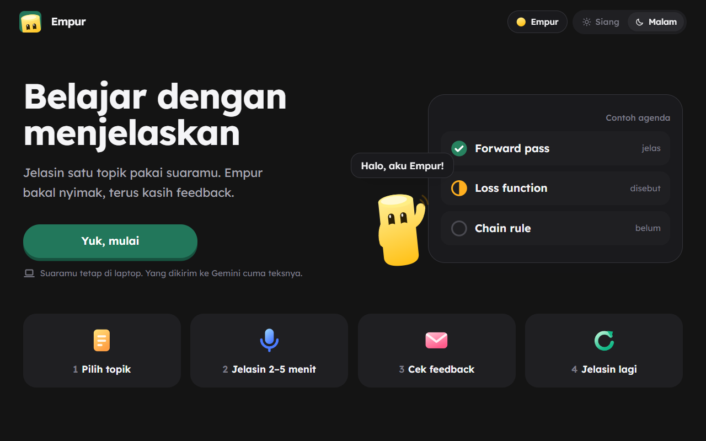
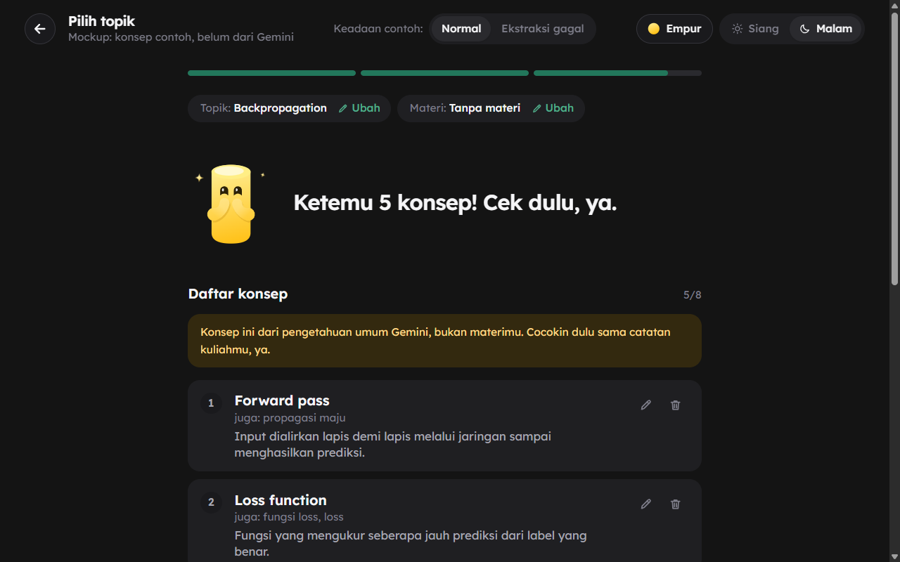
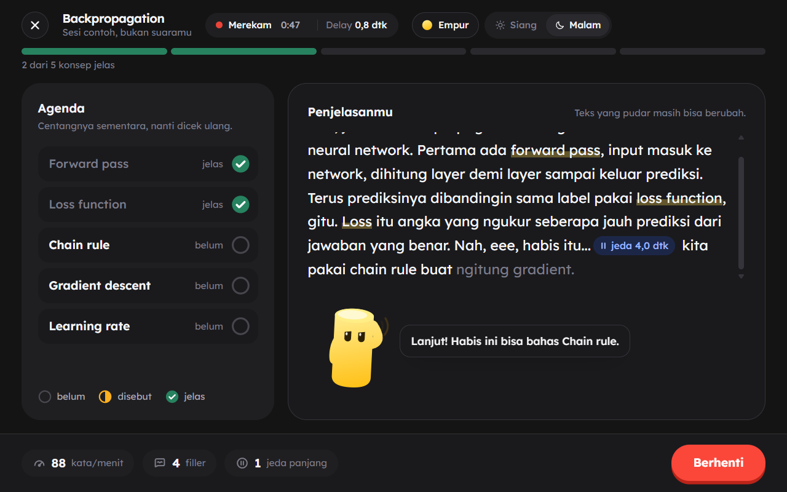
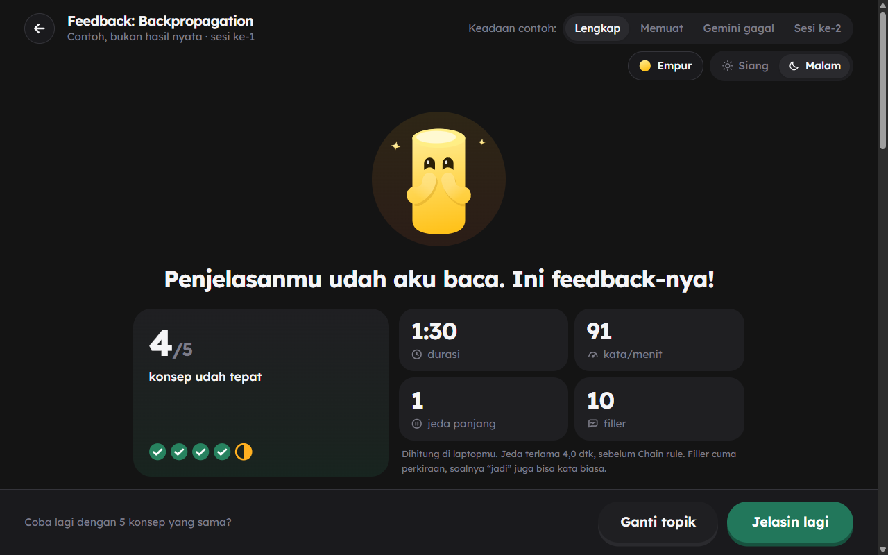

# Empur (Feynman Speech Coach)

Empur adalah aplikasi web untuk berlatih menjelaskan satu konsep secara lisan. Contohnya, user menjelaskan *backpropagation* selama 2–5 menit. Whisper menulis transkripnya secara *real-time* di laptop. Setelah sesi, user melihat konsep yang terlewat dan bagian yang kurang lancar.

Project ini adalah final project mata kuliah COMP6822001 Speech Recognition di BINUS University. README ini masih sementara.

## Showreel

[](https://youtu.be/IcO9DE_Yo7w)

## Screenshot

Semua screenshot di bawah masih memakai *mock data*.

| Beranda | Pilih topik |
| --- | --- |
|  |  |
| Sesi live | Feedback |
|  |  |

## Latar belakang

Metode Feynman adalah teknik belajar dengan cara menjelaskan konsep memakai bahasa sederhana. Bagian yang macet saat dijelaskan biasanya bagian yang belum dipahami.

Masalahnya, belajar sendiri dengan metode ini tidak memberi *feedback*. Tidak ada yang memberi tahu konsep mana yang terlewat atau istilah mana yang dipakai tanpa dijelaskan.

## Cara kerja

Satu sesi punya empat tahap:

1. Pilih topik. User mengetik topik, lalu aplikasi menyusun 4–8 konsep kunci sebagai *checklist*.
2. Jelaskan. User bicara ke mic. Transkrip muncul di layar selama user bicara, dan *checklist* berubah saat konsep dibahas.
3. Cek feedback. Setelah Stop, user melihat cakupan konsep dan metrik kelancaran, misalnya jumlah jeda dan *filler*.
4. Jelaskan ulang dengan daftar konsep yang sama, lalu bandingkan hasilnya.

## Arsitektur

```
Browser (mic)  --PCM 16 kHz-->  FastAPI /ws/transcribe  -->  faster-whisper (GPU)
               <---- JSON -----   transcript, status
```

### Keputusan desain

- ASR berjalan lokal. Aturan mata kuliah melarang API *speech recognition* eksternal. Akibatnya, audio user juga tidak pernah keluar dari laptop.
- Whisper bukan model *streaming*, jadi server memakai aturan *LocalAgreement-2*. *LocalAgreement-2* adalah aturan untuk memutuskan kata mana yang sudah pasti. Setiap 1 detik, server mentranskrip ulang seluruh *buffer* audio. Kata yang sama di dua hasil berturut-turut menjadi *confirmed*. Kata lainnya tetap *partial* dan masih bisa berubah.
- *Buffer* dipotong setelah lebih dari 15 detik. Tanpa pemotongan, waktu transkripsi ikut naik seiring panjang sesi, karena seluruh *buffer* ditranskrip ulang setiap detik.
- VAD (*voice activity detection*) membuang bagian hening sebelum audio masuk ke Whisper. Tanpa VAD, Whisper menambahkan "Terima kasih." di akhir rekaman pilot, padahal kalimat itu tidak diucapkan.
- Frontend tidak mengakses WebSocket langsung. Semua data transkrip lewat interface `TranscriptSource`. Karena itu, UI bisa dikembangkan dengan *mock data* sebelum backend selesai.
- Gemini hanya membaca teks transkrip setelah sesi, untuk menilai isi penjelasan. Metrik yang bisa dihitung dari suara, seperti jeda dan *speech rate*, tetap dihitung lokal.

### Tech stack

| Bagian | Teknologi |
| --- | --- |
| ASR | faster-whisper `large-v3-turbo`, `int8_float16`, Silero VAD |
| Backend | Python 3.12, FastAPI, WebSocket |
| Frontend | React, Vite, TypeScript, Tailwind |
| Analisis isi | Gemini |
| Evaluasi | jiwer untuk WER dan CER |
| Video | Remotion |

## Hasil awal: pemilihan model ASR

Pilot ini membandingkan empat model Whisper pada satu rekaman. Rekamannya berdurasi 101 detik, diambil di LKC BINUS Alam Sutera dengan keramaian di latar. Hardware-nya RTX 3050 Laptop 6 GB.

*Word error rate* (WER) adalah persentase kata yang salah dibandingkan naskah. Contohnya, WER 12,4% berarti 26 dari 209 kata salah. *Term recall* adalah persentase istilah teknis dari naskah yang muncul di transkrip. RTF (*real-time factor*) adalah waktu proses dibagi durasi audio. RTF 0,067 berarti audio 101 detik selesai dalam sekitar 7 detik.

| Model | WER | Term recall | RTF | VRAM |
| --- | --- | --- | --- | --- |
| `large-v3-turbo` | 12,4% | 91,1% | 0,067 | 993 MB |
| `medium` | 13,4% | 86,7% | 0,148 | 929 MB |
| `cahya/faster-whisper-medium-id` | 20,1% | 77,8% | 0,138 | 929 MB |
| `small` | 22,0% | 82,2% | 0,099 | 385 MB |

Temuan:

- Model yang di-*fine-tune* ke bahasa Indonesia justru lebih buruk. Dibanding `medium`, WER-nya naik dari 13,4% ke 20,1%. Model ini menulis istilah Inggris dengan ejaan Indonesia, misalnya "epoch" menjadi "ipok". Data latihnya (Common Voice, TITML, Magic Data) berisi bahasa Indonesia baku tanpa istilah Inggris.
- `large-v3-turbo` dipilih sebagai default karena RTF-nya sekitar setengah RTF `medium`. Selisih akurasinya hanya 2 kata. Angka itu belum cukup untuk menyebut turbo lebih akurat.
- Beberapa istilah salah di hampir semua model. "output layer" menjadi "octave layer", dan "weight" menjadi "width". *Hotwords* adalah daftar istilah yang diberikan ke Whisper supaya lebih mudah dikenali. Istilah-istilah ini jadi bahan uji *hotwords* berikutnya.

Pilot ini hanya memakai satu rekaman dan satu pembicara. *Latency streaming* belum diukur resmi: [perlu data]. Detail lengkapnya ada di [docs/eksperimen/2026-10-13-pilot-model.md](docs/eksperimen/2026-10-13-pilot-model.md).

## Status

- [x] Transkripsi *streaming* dari mic ke server Whisper lokal
- [x] Replay rekaman ke pipeline *streaming* untuk menghitung WER, CER, *term recall*, dan *latency*
- [x] UI empat layar, termasuk ekstraksi konsep dari topik dan materi (PDF, PPTX, TXT, MD) dengan Gemini.
- [x] Pipeline *fine-tuning* LoRA untuk Whisper. Data rekamannya masih dikumpulkan.
- [x] Metrik kelancaran live dan analisis isi dengan Gemini. Kalau Gemini gagal, aplikasi memakai *feedback* lokal.
- [x] *Checklist* konsep live dengan dua status, belum dan dibahas, serta *hotwords* dari daftar konsep
- [ ] Eksperimen resmi dan user testing dengan minimal 5 user

## Setup

Requirements: GPU NVIDIA, Python 3.12, dan Node.js. CUDA Toolkit tidak perlu diinstal, karena cuBLAS ikut terpasang lewat pip. Perintah di bawah untuk Windows dengan Git Bash.

Backend:

```bash
python -m venv backend/.venv
backend/.venv/Scripts/pip install -r backend/requirements.txt
backend/.venv/Scripts/python -m uvicorn app:app --app-dir backend --port 8000
```

Saat pertama dijalankan, faster-whisper mengunduh model dari Hugging Face. Semua parameter ada di `backend/config.py`. Kalau VRAM tidak cukup, ganti `ASR_MODEL` ke `small`. Model ini hanya butuh 385 MB di pilot.

Frontend:

```bash
npm --prefix frontend install
npm --prefix frontend run dev
```

Buka `http://localhost:5173`. Untuk fitur Gemini, salin `.env.example` menjadi `.env`, lalu isi `GEMINI_API_KEY`.

Testing:

```bash
backend/.venv/Scripts/python -m pytest backend eval finetune
npm --prefix frontend test
```

## Struktur folder

| Folder | Isi |
| --- | --- |
| `backend/` | Server FastAPI dan pipeline ASR *streaming* |
| `frontend/` | Aplikasi React |
| `eval/` | Replay rekaman, normalisasi teks, dan perhitungan metrik |
| `finetune/` | Pipeline *fine-tuning* LoRA dan notebook Colab |
| `video/` | Video promo dan showreel |
| `docs/` | Rencana project, hasil eksperimen, dan wireframe |

Rencana lengkap project ada di [docs/PLAN.md](docs/PLAN.md).
